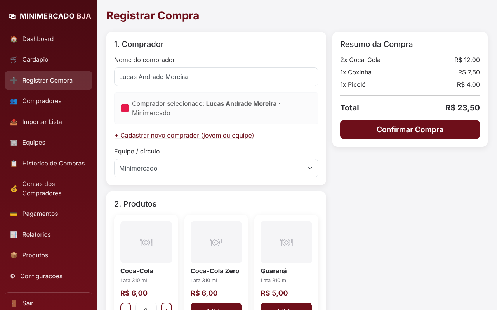
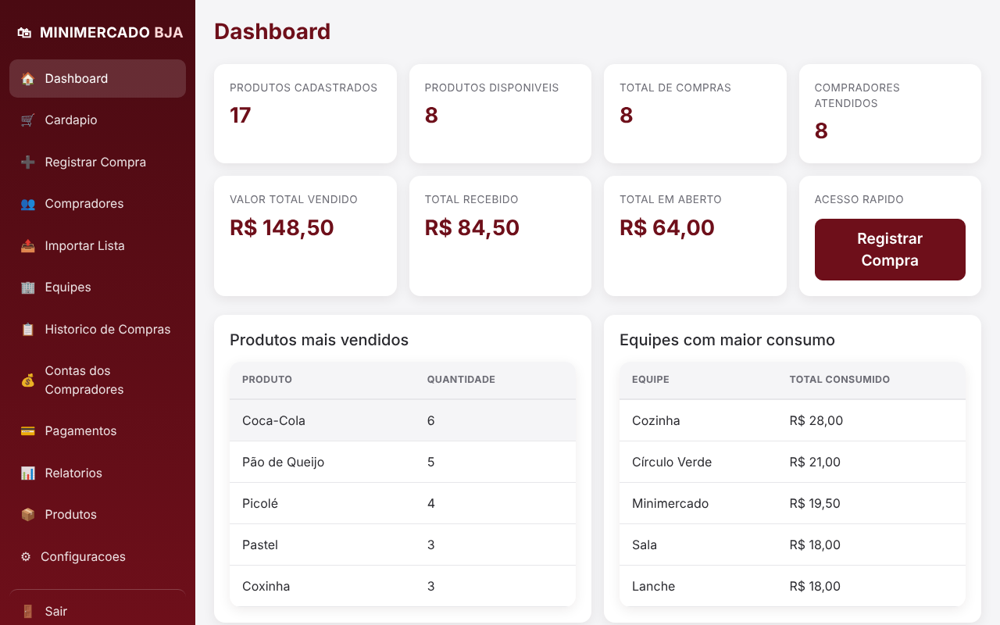
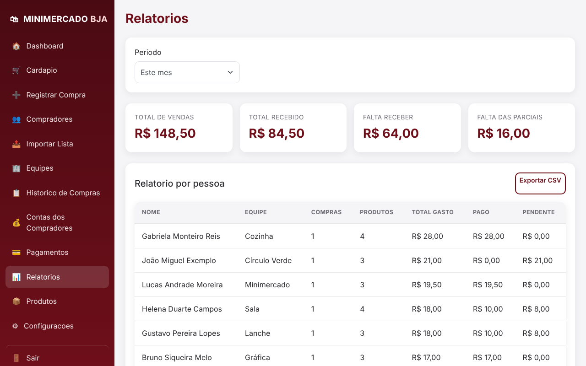
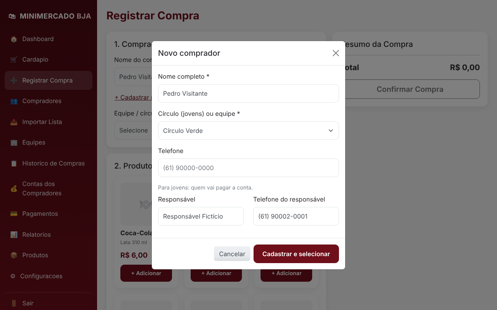
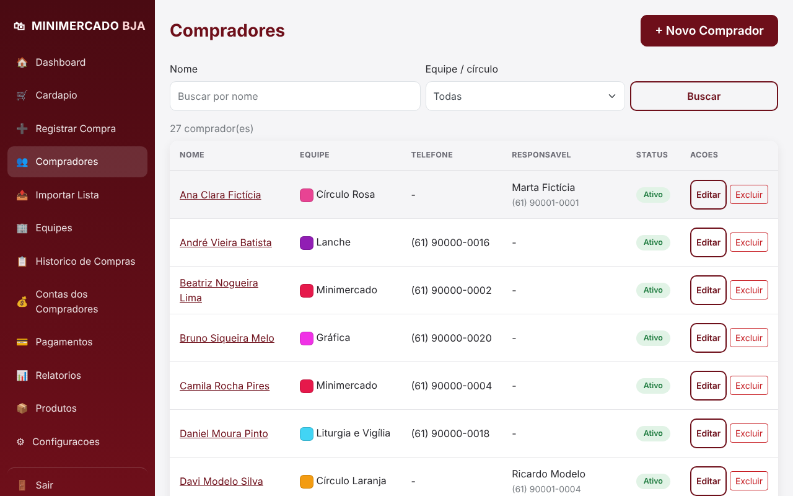
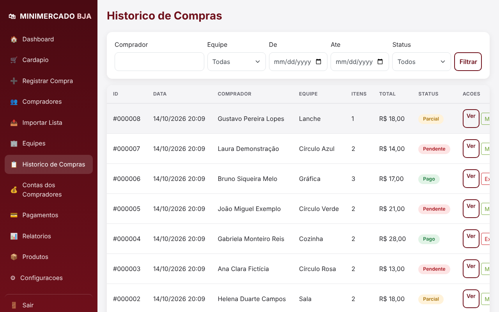
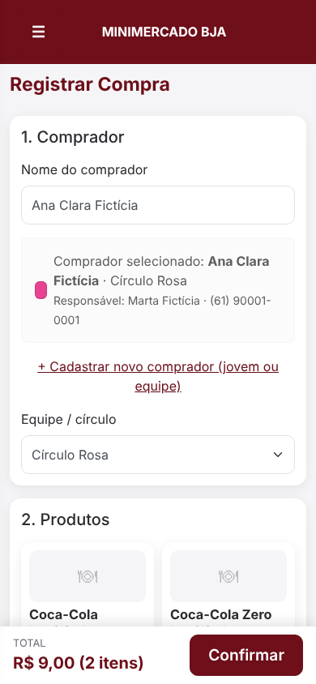
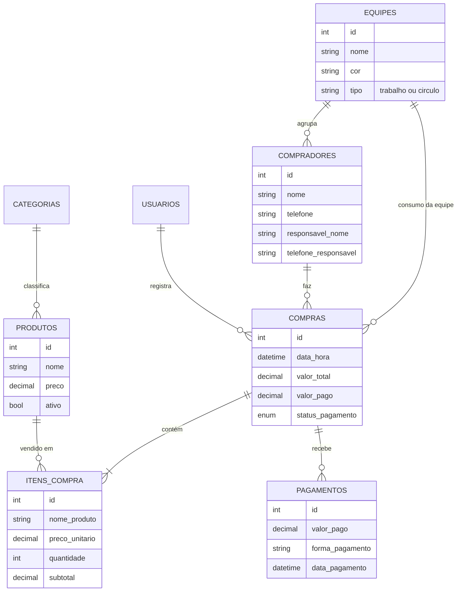

# Minimercado BJA


Sistema web de **vendas com conta (fiado) para o minimercado de um encontro de jovens** de uma paróquia.
Quem trabalha nas equipes e os jovens do encontro compram ao longo do fim de semana; o sistema registra
cada compra na conta da pessoa e o pagamento é feito depois, no todo ou em partes, por ela ou por um responsável.

Feito para ser usado **em tablet e celular, no balcão**, por voluntários sem treinamento.

<p align="center">
  
</p>

## O problema

No encontro, cerca de 240 jovens e 190 voluntários (divididos em 17 equipes e 4 círculos por cor) compram
lanches e bebidas sem pagar na hora. Antes, o controle era em papel: difícil saber quanto cada pessoa devia,
quem já tinha pago e quanto cada equipe consumiu. O sistema resolve isso com:

- registro da compra em poucos toques (busca pelo nome, cor da equipe para confirmar a pessoa certa);
- conta individual com saldo, pagamentos parciais e responsável pelo pagamento (menores de idade);
- relatórios por pessoa, equipe e produto para o fechamento do caixa.

## Funcionalidades

| Área | O que faz |
|---|---|
| **Registrar compra** | Busca o comprador com autocompletar (mostra a cor da equipe/círculo), carrinho com +/–, total em tempo real, barra fixa de total no celular. Comprador que não está na lista é cadastrado ali mesmo, sem sair da tela. |
| **Compradores e equipes** | Equipes de trabalho e círculos dos jovens (rosa, verde, azul e laranja), cada um com sua cor. Filtro por nome e por equipe. Responsável e telefone para menores. |
| **Importação de planilhas** | Importa participantes e cardápio por CSV (Excel/Google Planilhas), reconhece títulos de coluna com ou sem acento, não duplica nomes, cria equipes com cores distintas. Produto sem preço entra indisponível. |
| **Pagamentos** | Pagamento parcial ou total, várias formas (Pix, dinheiro, cartão), bloqueia valor acima do saldo, histórico por compra. |
| **Relatórios** | Por pessoa, por equipe e por produto, com período (hoje, 7 dias, mês, personalizado) e exportação CSV. |
| **Diagnóstico** | Página que verifica banco, estrutura, relógio, produtos com preço e compradores, explicando por que uma tela pode estar vazia. |

<details>
<summary><strong>Mais capturas de tela</strong></summary>

| Painel | Relatórios |
|---|---|
|  |  |
| **Cadastro rápido de jovem** | **Compradores com filtro** |
|  |  |
| **Histórico** | **Celular** |
|  |  |

Todas as capturas usam **dados fictícios** (`tests/fixtures`).
</details>

## Tecnologias

- **PHP 8** puro, sem framework, com **PDO** e *prepared statements*
- **MySQL / MariaDB** (produção) e **SQLite** (testes)
- **Bootstrap 5** servido localmente (funciona sem internet na rede local) + JavaScript sem bibliotecas
- **Testes**: Bash + cURL (ponta a ponta via HTTP) e **Playwright** (navegador real, 4 tamanhos de tela)
- **GitHub Actions** para rodar os testes a cada envio

## Estrutura

```
app/                    o sistema (é esta pasta que vai para o servidor)
├── api/                endpoints JSON usados pela tela de compra
├── assets/             CSS, JS, Bootstrap local e planilhas modelo
├── config/             configuração e conexão (credenciais ficam fora do git)
├── database/           schema.sql (local) e schema_hospedagem.sql (phpMyAdmin)
├── includes/           cabeçalho, menu, funções e migração automática do banco
├── *.php               páginas do sistema
├── instalar_ubuntu.sh  instalação automática em Ubuntu (Apache + MySQL)
└── backup_banco.sh     backup periódico do banco
docs/                   guia do evento, instalação e capturas de tela
tests/                  testes de ponta a ponta, navegador e dados fictícios
```

## Modelo de dados



O item da compra guarda **nome e preço do momento da venda**: mudar o preço no cardápio nunca altera compras já feitas.

## Decisões técnicas

- **O preço vem sempre do banco.** O navegador envia só produto e quantidade; o servidor busca nome e preço
  e recalcula o total dentro de uma transação. Um preço adulterado no navegador é ignorado (há teste para isso).
- **Segurança:** *prepared statements* em todas as consultas, token **CSRF** em formulários e ações por link,
  senhas com **bcrypt**, sessão com `HttpOnly`/`SameSite` e `Secure` em HTTPS, bloqueio após 8 senhas erradas,
  aviso enquanto a senha padrão não for trocada, pastas internas bloqueadas por `.htaccess` e `noindex`.
- **Migração automática do banco.** Bancos criados por versões antigas recebem as colunas novas sozinhos
  (`includes/migracao.php`), sem perder dados. Esse foi o defeito que deixava telas vazias em produção:
  o código esperava colunas que o banco antigo não tinha.
- **Um só relógio.** Datas são geradas pelo PHP em `America/Sao_Paulo` e a sessão do MySQL usa o mesmo fuso,
  para que compras feitas à noite não "pulem" para o dia seguinte nos filtros.
- **Feito para o balcão.** Botões com área de toque grande, menu em gaveta abaixo de 1100 px, dois produtos
  por linha no celular, barra fixa com total e confirmar, mensagens que dizem *por que* uma lista está vazia.
- **Dados pessoais (LGPD).** Só são guardados nome, equipe e telefone. As listas reais nunca entram no
  repositório (`.gitignore`); testes e capturas usam dados fictícios.

## Como rodar

### Em 1 minuto (PHP + SQLite, só para conhecer)
Requisitos: PHP 8 com `pdo_sqlite` e `mbstring`, Python 3 e cURL.

```bash
python3 tests/preparar_teste.py app /tmp/minimercado novo   # copia o app e cria um banco SQLite
cd /tmp/minimercado && php instalar.php && cd -              # cria o usuário admin
php -S localhost:8000 -t /tmp/minimercado &                  # sobe o servidor embutido
bash tests/popular_demo.sh 8000 tests/fixtures              # dados fictícios (opcional)
```
Acesse `http://localhost:8000` e entre com **admin / demo-portfolio** (ou **admin / admin123** sem a demo).

### Em produção
- **Hospedagem compartilhada (Hostinger, etc.):** passo a passo em [`docs/GUIA_EVENTO.md`](docs/GUIA_EVENTO.md#0-onde-o-sistema-vai-rodar).
- **Ubuntu (rede local, sem internet):** `sudo bash app/instalar_ubuntu.sh`.
- **Windows (XAMPP):** [`docs/INSTALACAO_XAMPP.md`](docs/INSTALACAO_XAMPP.md).

## Testes

```bash
bash tests/run_tests.sh
```

Verifica a sintaxe de todos os arquivos e sobe o sistema duas vezes, com **banco novo** e com **banco de
versão antiga** (testando a migração). Em cada um roda **79 verificações de ponta a ponta**: importação,
cadastro rápido, compra, pagamentos parciais, filtros, relatórios, CSV, CSRF e bloqueio de senha. Com o
Playwright instalado, roda também **24 verificações no navegador** em quatro tamanhos de tela (tablet deitado,
tablet em pé e celular), conferindo que nenhuma tela tem rolagem lateral.

## Próximos passos

- Perfis de acesso (operador de caixa × coordenação)
- Leitura de QR Code no crachá para identificar o comprador
- Controle de estoque das bebidas consignadas
- Funcionamento offline no tablet com sincronização

## Autor

**Victor Carvalho dos Santos** — estudante de Engenharia de Software.
Projeto criado para o V Segue-me da Paróquia Bom Jesus dos Aflitos (equipe Minimercado).

Licença [MIT](LICENSE).
